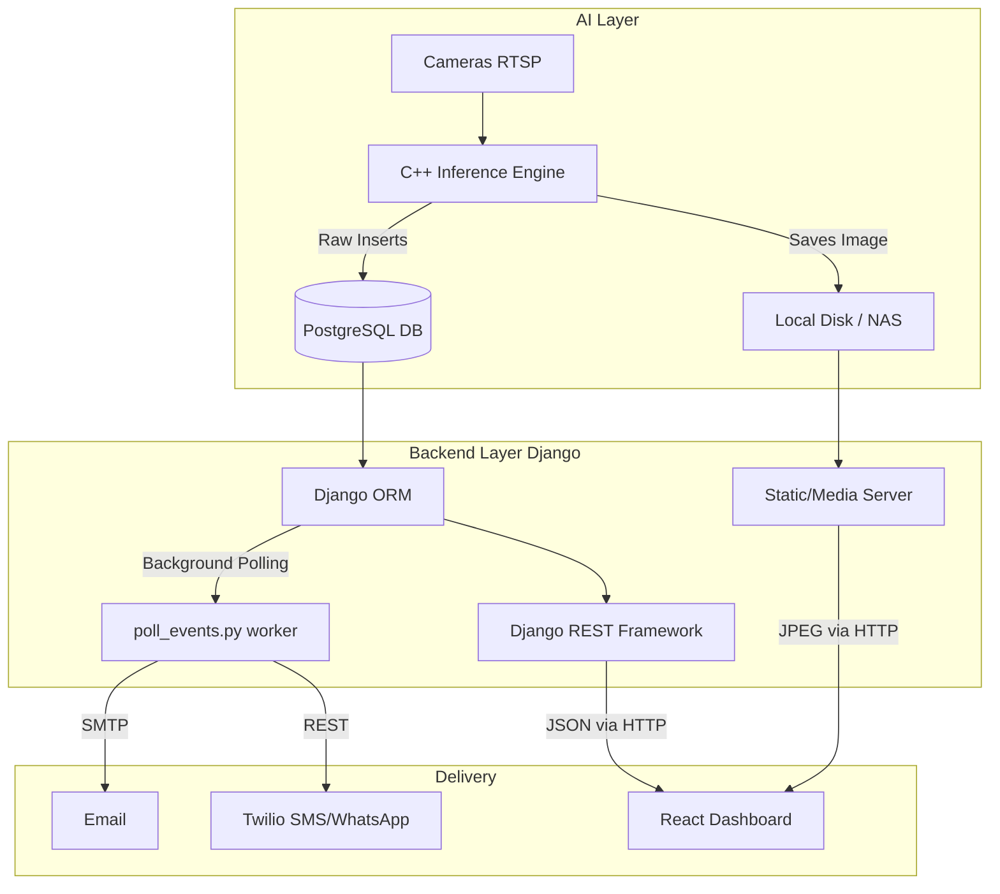

# Comprehensive System Architecture Documentation

This document serves as the master architectural and developer guide for the Safelens AI Platform. It covers the overall project design, strategy, protocols, file-by-file explanations for both frontend and backend, database schema breakdown, and a complete API specification.

---

## 1. Project Design & Approach

The Safelens AI Platform adopts a modern, decoupled architecture:
1.  **AI Engine (C++):** A standalone process that interfaces with IP cameras, runs machine learning models (YOLO variants) on RTSP streams, and writes raw detection events directly to a shared PostgreSQL database.
2.  **Backend API (Django):** A Python-based RESTful API using Django REST Framework (DRF). It acts as the business logic layer, authenticating users, aggregating raw data for the dashboard, dispatching multi-channel alerts (SMS, Email, WhatsApp) via background workers, and providing an Admin interface.
3.  **Frontend Dashboard (React):** A Single Page Application (SPA) built with React (Vite) and TailwindCSS. It consumes the Django API to visualize real-time incidents, historical graphs (Recharts), and provide system administration controls.

### 1.1 Architectural Flow Diagram



---

## 2. Technologies & Protocols

*   **HTTP/HTTPS:** All communication between the React Frontend and Django Backend happens over standard HTTP methodology (GET, POST, PUT, PATCH, DELETE) using the Axios library.
*   **Authentication:** Token-based authentication using Django REST Framework's `TokenAuthentication`. Upon login, a token is issued to the client, which must be attached to the `Authorization: Token <token>` header of every subsequent API request.
*   **Database:** PostgreSQL (Relational Database) accessed exclusively via the Django ORM.
*   **Email Protocol:** SMTP (Simple Mail Transfer Protocol) using Django's built-in `django.core.mail` module connected to an external relay (e.g., Gmail).
*   **SMS/WhatsApp Protocol:** REST API via the Twilio Python SDK (`twilio.rest.Client`), authenticated via Account SID and Auth Token.

---

## 3. Database Schema Details (api/models.py)

The database schema is distinctly split into two categories: **Unmanaged** (controlled by the C++ engine) and **Managed** (controlled by Django).

### 3.1 Unmanaged Tables (`managed = False`)
Django can *read* these, but does not modify their structure via `makemigrations`.
*   **`events` (`Event`):** The core table. Every safety violation creates one row here. Stores `camera_id`, `event_type` (e.g., 'PPE_VIOLATION', 'INTRUSION'), and `timestamp`.
*   **`camera` (`Camera`):** Stores camera metadata, specifically its `name` and physical `location` (used for alert routing).
*   **`frames` (`Frame`):** Stores the physical `storage_path` of the incident snapshot.
*   **`event_media_map` (`EventMediaMap`):** A join table linking an `event_id` to a `media_id` (like a frame) using a `media_type` string.
*   **`events_detections` (`EventDetection`):** child records for an event detailing specific bounding boxes or missing items (e.g., missing helmet, missing vest).

### 3.2 Managed Tables (`managed = True`)
Django has full CRUD control over these.
*   **`user_profiles` (`UserProfile`):** Extends standard `auth_user`. Essential fields:
    *   `role`: Admin, Manager, Support.
    *   `location`: Must match the camera location for geographically routed alerts.
    *   `alerts_email`, `alerts_sms`, `alerts_whatsapp`: Individual preference switches.
*   **`user_activity_log` (`UserActivityLog`):** Tracks `login_time` and `logout_time`. An empty `logout_time` indicates the user is "Online" and eligible for SMS/WhatsApp alerts.
*   **`email_alert_tracker` (`EmailAlertTracker`):** A singleton system config row. Holds the global master switches (`is_email_enabled`, `is_sms_enabled`, `is_whatsapp_enabled`) and the `last_event_id` processed by the background worker.
*   **`event_reviews` (`EventReview`):** Allows dashboard users to mark an unmanaged event as "Closed" and leave text comments.

---

## 4. Backend File-by-File Strategy (`database-api/`)

The Django backend follows strict MVC (Model-View-Template, though 'Template' is replaced by JSON Serializers for the API) conventions.

### Directory: `api/` (Core Application)
*   **`models.py`**: Defines the Python representation of all database tables (see Section 3). Includes Django Signals (`@receiver`) that automatically create a `UserProfile` whenever a new `User` is created.
*   **`serializers.py`**: Converts complex Model instances into JSON. Handles validation before saving data. Notably, `UserProfileSerializer` restricts Managers from elevating their own roles to Admin.
*   **`views.py`**: Contains the business logic controllers.
    *   *ViewSets:* `EventViewSet`, `UserViewSet` automatically map to typical CRUD operations.
    *   *Custom APIViews:* `CustomAuthToken` (handles login and logs the activity), `LogoutView` (updates the activity log), `RoleListView`/`LocationListView` (serve dynamic dropdown options).
    *   *Aggregation:* `OverviewViewSet` is a massive custom ViewSet that parses raw events and groups them by hour/day/month to feed the React Recharts components.
*   **`urls.py`**: Routes incoming HTTP requests (like `/api/events/`) to the appropriate View/ViewSet using DRF Routers.
*   **`admin.py`**: Configures the built-in Django Administration panel. Customizes how `UserProfiles` and `EmailAlertTracker` look in the backend UI.

### Directory: `api/management/commands/`
*   **`poll_events.py`**: The background worker daemon. It runs an infinite loop querying the DB for new `Events`, formats email/SMS payloads, calculates the recipient list based on routing rules (matching locations, online status), and dispatches them via SMTP and Twilio.

### Directory: `safelensai/` (Project Configuration)
*   **`settings.py`**: The heart of Django config. Defines the database connection (`DATABASES`), Installed Apps, CORS rules (allowing React to talk to Django), and credential variables (Twilio SID, SMTP passwords).
*   **`urls.py`**: The master URL router that includes `api/urls.py` and provides a custom `serve_absolute_media` function to securely serve JPEG frames from local disk storage to the frontend.

---

## 5. Frontend File-by-File Strategy (`frontend-dashboard/src/`)

The React frontend handles all user interaction, built using Vite for fast bundling.

### Configuration & Base
*   **`App.jsx`**: The root component. Handles React Router (`react-router-dom`) setup, defining unprotected routes (`/`) and protected routes (Dashboard, Settings).
*   **`axiosSetup.js`**: The network layer. Configures an Axios instance (`api`) with the base URL. It includes *Interceptors*:
    *   *Request:* Automatically attaches the `Authorization: Token xyz` header to every outgoing API call.
    *   *Response:* Detects `401 Unauthorized` errors and automatically fires a "session-expired" event to kick the user back to the login screen.
*   **`index.css`**: Contains global TailwindCSS imports and custom theme variables.

### Directory: `components/`
*   **`LoginCard.jsx`**: The authentication entry point. Captures username/password, hits `/api/login/`, and saves the returned Token to `localStorage`.
*   **`Dashboard.jsx`**: The main interface.
    *   Uses `useEffect` hooks to poll `/api/overview/latest/` every few seconds to build a real-time table of incidents.
    *   Uses `/api/overview/graph/` and `/api/overview/summary/` to render visual Recharts.
    *   Includes a modal logic to view images associated with events and submit `EventReview` comments.
*   **`UserManagement.jsx`**: Admin/Manager panel to CRUD (Create, Read, Update, Delete) system users. Restricted functionally based on the logged-in user's role (e.g., Managers cannot create Admins).
*   **`SystemSettings.jsx`**: An Admin-only panel that interacts with `/api/settings/` to toggle the global Email, SMS, and WhatsApp alert switches.

---

## 6. Full API Endpoint Specification

All endpoints are prefixed with the base URL (e.g., `http://192.168.1.59:8000`). All endpoints (except Login) require an HTTP Header: `Authorization: Token <your_token>`.

### 6.1 Authentication & Session
| Endpoint | Method | Purpose | Status Codes |
| :--- | :--- | :--- | :--- |
| `/api/login/` | `POST` | Authenticate user, returns Token, Role, Location. Begins session in `UserActivityLog`. | 200 (Success), 400 (Invalid credentials) |
| `/api/logout/` | `POST` | Invalidates token locally and updates `UserActivityLog.logout_time` to timestamp. | 200 (Success), 401 (Unauthorized) |

### 6.2 Data Aggregation & Dashboard (OverviewViewSet)
*Note: All overview endpoints auto-filter data based on the Requesting User's `location` if they are a Manager/Support role.*

| Endpoint | Method | Purpose | Query Params | Status Codes |
| :--- | :--- | :--- | :--- | :--- |
| `/api/overview/latest/` | `GET` | Returns list of recent events. | `limit` (int), `since_id` (int, for polling) | 200 |
| `/api/overview/events/` | `GET` | Returns list of events. | `date`, `start_date`, `end_date`, `time_range`, `type` | 200 |
| `/api/overview/summary/` | `GET` | Returns % calculations and counts for Fall/PPE/Intrusion. | `date`, `start_date`, `end_date`, `time_range`, `type` | 200 |
| `/api/overview/graph/` | `GET` | Returns data mapped for Recharts stacked bar charts. | `time_range`, `type` | 200 |

### 6.3 Standard Entities (ViewSets)
These endpoints provide standard RESTful operations automatically generated by DRF Routers. Actions generally include `GET` (List/Retrieve), `POST` (Create), `PUT`/`PATCH` (Update), and `DELETE` (Destroy).

| Endpoint | Supported Methods | Description | Status Codes |
| :--- | :--- | :--- | :--- |
| `/api/users/` | `GET`, `POST`, `PATCH`, `DELETE` | CRUD operations for Users and their nested UserProfiles. | 200, 201 (Created), 400 (Bad Data), 403 (Permission Denied) |
| `/api/events/` | `GET` (Read-only) | Raw access to the unmanaged `events` table with pagination. | 200 |
| `/api/decisions/`| `GET`, `POST`, `PATCH`, `DELETE`| Manage access decisions linked to events. | 200, 201, 204 |
| `/api/reviews/` | `GET`, `POST`, `PATCH` | Create/Update status (Open/Closed) and comments for an unmanaged event. | 200, 201 |
| `/api/cameras/` | `GET` | Read-only access to available cameras. | 200 |

### 6.4 System Configuration & Utilities
| Endpoint | Method | Purpose | Status Codes |
| :--- | :--- | :--- | :--- |
| `/api/settings/` | `GET` | Retrieves the Global Switch state (Email/SMS/WA). | 200 |
| `/api/settings/update_switches/`| `PATCH`| Updates the Global Switch state (Admin Only). | 200, 403 |
| `/api/notifications/send/` | `POST` | Manually triggers an alert for a specific `event_id`. | 200, 400 (Missing ID), 404 (Event not found) |
| `/api/locations/` | `GET` | Returns unique list of assigned user locations for dropdowns. | 200 |
| `/api/roles/` | `GET` | Returns standard platform roles for dropdowns. | 200 |
| `/<absolute_path>` | `GET` | Custom media server route (set up in `safelensai/urls.py`) to bypass relative pathing and securely serve exact physical files from the Linux disk. | 200 (File Stream), 404 (Not Found Error JSON) |

---

## 7. Complete Directory and File Structure

Understanding where files live is critical for navigating the Safelens AI platform.

```text
Worker-Safety-API/
├── manage.py                    # Django's dev server and DB management tool.
├── requirements.txt             # Python dependencies (django, djangorestframework, psycopg2, etc.)
├── safelensai/           # The global Django configuration folder.
│   ├── __init__.py
│   ├── settings.py              # Central config (Database, Email, Twilio, Apps).
│   ├── urls.py                  # Global URL router. Connects `/api/` to `apps.api.urls`.
│   └── wsgi.py                  # Entry point for production servers (like Gunicorn).
├── api/                         # The main Django application handling business logic.
│   ├── __init__.py
│   ├── admin.py                 # Registers Managed models to the `localhost:8000/admin` panel.
│   ├── apps.py                  # App configuration.
│   ├── models.py                # Defines Managed (UserProfiles) and Unmanaged (Events) DB tables.
│   ├── serializers.py           # Translates complex DB objects (Events) into JSON for React.
│   ├── urls.py                  # Routes API endpoints to `views.py`.
│   ├── views.py                 # Business logic: handles requests, queries DB, returns Serializers.
│   └── management/
│       └── commands/
│           └── poll_events.py   # Background python script that sends Twilio/Email alerts.
└── frontend-dashboard/          # The React Single Page Application (Vite).
    ├── package.json             # NPM dependencies.
    ├── vite.config.js           # Vite bundler configuration.
    ├── index.html               # Main HTML entry point.
    └── src/
        ├── App.jsx              # React Router setup (Protected vs Unprotected routes).
        ├── main.jsx             # React DOM rendering entry point.
        ├── index.css            # Tailwind CSS classes and global styles.
        ├── axiosSetup.js        # Configures API base URL and automatic Token attachment.
        └── components/
            ├── Dashboard.jsx        # Main overview: Charts, Data Tables, Modal galleries.
            ├── LoginCard.jsx        # Authentication form, saves Token to localStorage.
            ├── SystemSettings.jsx   # Admin UI to toggle the Global Alert Switches.
            └── UserManagement.jsx   # Admin/Manager UI to view/create/edit users and locations.
```

---

## 8. Step-by-Step Learning and Development Roadmap

If you are a new developer aiming to understand or extend this project, follow this recommended sequence of study.

### Phase 1: The Basics (External Concepts)
Do not touch the code until you understand its foundational blocks.
1. **Python and Django Fundamentals:** Understand how `views.py` processes requests, how `urls.py` routes them, and how `models.py` represents database tables.
2. **Django REST Framework (DRF):** Learn the difference between a standard Django Template View and a DRF `ViewSet`. Understand how `serializers.py` turns Python objects into JSON.
3. **React and Vite:** Understand Component lifecycles (specifically `useEffect` for fetching data) and State management (`useState`).

### Phase 2: Understanding the Existing Codebase
Read the specific files in this exact order:
1.  **`safelensai/settings.py`**: Look at `DATABASES`, `INSTALLED_APPS`, and custom environment variables (Twilio, Email).
2.  **`api/models.py`**: Read the classes. Note which ones have `managed = False` (you cannot alter these) vs `managed = True` (you control these).
3.  **`api/urls.py`**: See how URLs map to ViewSets.
4.  **`api/views.py`**: Look at `OverviewViewSet` to see how raw data is aggressively aggregated using Django ORM functions (like `TruncHour`) to serve charts.
5.  **`frontend-dashboard/src/axiosSetup.js`**: See how every frontend request talks to the backend and handles authentication tokens.
6.  **`frontend-dashboard/src/components/Dashboard.jsx`**: Observe how React fetches the aggregated data and feeds it into `Recharts` components.

### Phase 3: Extending the Platform
When you need to build a new feature (e.g., adding an "Attendance" tracking feature):
1.  **Database:** Is it managed or unmanaged? If managed, create the model in `api/models.py` and run `python manage.py makemigrations` and `migrate`.
2.  **Backend Logic:** Create a Serializer in `api/serializers.py`. Create a ViewSet in `api/views.py`. Register the router path in `api/urls.py`.
3.  **Frontend Layout:** Create a new React Component in `frontend-dashboard/src/components/`, import `api` from `axiosSetup.js` to fetch your new endpoint, and link the page in `App.jsx`.

---

## 9. Master Documentation Reading Order & Implementation Guide

The documentation set is now numbered for easier onboarding. If you are joining
the project, maintaining it, or implementing a new feature, start with
`01_START_HERE.md` and then use this order.

### Phase 1: Business Requirements & High-Level Design
1. **`00_PRODUCT_SPECIFICATION.docx`**
   - **What it is:** The original product specification and business requirements document.
   - **How to use it:** Read this **first** to understand *what* the customer requested, the overall business goals of the dashboard, and the high-level API needs before diving into any code.

2. **`01_START_HERE.md`**
   - **What it is:** The master index for the documentation set.
   - **How to use it:** Read this right after the product specification to pick the right reading path.

3. **`04_COMPREHENSIVE_SYSTEM_ARCHITECTURE.md`** (This Document)
   - **What it is:** The "Bird's Eye View" of the entire stack.
   - **How to use it:** Read this to understand how the React frontend, Django Backend, and C++ AI Engine interact together, and to learn the Database schema (Managed vs Unmanaged).

### Phase 2: Technical Implementation Details
Once you understand the goal, read these documents to understand how the code actually achieves it.

4. **`05_PROJECT_ARCHITECTURE_AND_CODE_WALKTHROUGH.md`**
   - **What it is:** A narrative guide on how the Django project was bootstrapped and a step-by-step trace of how a single HTTP request travels from `urls.py` down to `models.py`.
   - **How to use it:** Read this to trace the exact execution path of the backend code. 

5. **`09_UI_DOCUMENTATION.md`**
   - **What it is:** A massive, highly detailed visual guide of the React Frontend. It maps every single button click (like the Date Picker or Incident Dropdown) directly to the API call it triggers and the SQL query it executes.
   - **How to use it:** Use this when modifying the React Dashboard (`frontend-dashboard/src/`). It tells you exactly what React State (`useState`) maps to what Backend Data.

6. **`08_API_DOCUMENTATION.md`**
   - **What it is:** A standard API reference (Swagger-style) listing endpoints, methods, parameters, and JSON response examples.
   - **How to use it:** Keep this open as a reference manual when testing the backend with Postman or `curl`, or when writing new Axios calls in the frontend.

7. **`10_NOTIFICATION_ARCHITECTURE.md`**
   - **What it is:** A specialized deep-dive into the automated Email, SMS, and WhatsApp engine (`poll_events.py`).
   - **How to use it:** Read this if you need to change the text of the SMS alerts, modify the Twilio API keys, or understand the "Online Status" and "Location Routing" rules that prevent alert spam.

### Phase 3: Developer Onboarding & History
8. **`03_DEVELOPER_HANDBOOK.md` & `02_LEARNING_ROADMAP.md`**
   - **What it is:** Resources for junior developers explaining the external tools installed (like `django-cors-headers`, `gunicorn`, `psycopg2`).
   - **How to use it:** Read these if you have never used Django REST Framework before and need links to official tutorials to close your knowledge gaps.

9. **`06_DEVELOPMENT_GUIDE.md`**
   - **What it is:** A historical diary of *why* certain code was written complexly (e.g., the complex PPE violation extraction logic).
   - **How to use it:** Read this before you try to "refactor" or "simplify" complex backend views, as it explains the edge cases those views were built to handle.
   
10. **Role-Specific and Operations Guides**
   - **`11_USER_MANAGEMENT_GUIDE.md`**: Read to understand the Admin vs Manager vs Support permissions.
   - **`12_TESTING_GUIDE.md` / `07_RUN_AND_VERIFY.md` / `13_DEPLOYMENT_GUIDE.md`**: Read these when it is time to write unit tests, run the server locally, or deploy to a production Linux server.
   - **`14_PRODUCTION_HANDOVER_MANUAL.md` / `database/16_RDS_PROVISIONING_GUIDE.md`**: Read these when you need the EC2 and RDS production setup details.
