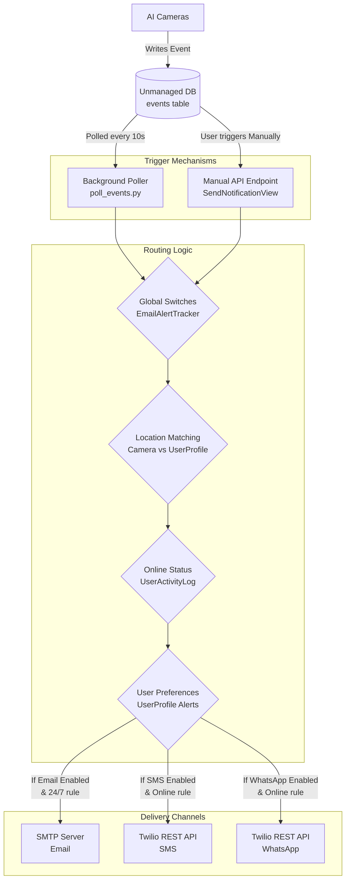

# Safelens AI Alert Notification System Architecture

This document provides a comprehensive guide to the Alert Notification System in the Safelens AI Backend. It covers the mechanisms, protocols, and codebase components responsible for dispatching Email, SMS, and WhatsApp alerts when safety incidents occur.

## 1. System Overview & Architecture

The notification system acts as the communication layer, taking safety events detected by the AI cameras and routing them to the appropriate personnel based on their roles, locations, and personal preferences, while adhering to global system switches.



## 2. Technology Stack & Protocols

*   **Email (SMTP):** Uses standard Django `django.core.mail.send_mail` and `EmailMessage` classes. It connects to an external SMTP server (e.g., Gmail, SendGrid, Amazon SES) configured in `settings.py`.
*   **SMS & WhatsApp (REST API):** Powered by **Twilio**. Uses the official `twilio` Python package (`twilio.rest.Client`). It requires a Twilio Account SID, Auth Token, and configured sender numbers. It communicates over HTTPS.

## 3. Database Schema and Models

The notification routing logic depends on several physical database tables.

### 3.1 Unmanaged Models (Read-Only from AI Engine)
*   **`Event` (`api/models.py`):** The core table representing a safety incident. Notifications are generated based on rows in this table.
*   **`Camera` (`api/models.py`):** Linked to the Event. The camera's `location` field is crucial for Location-Based Routing.
*   **`Frame` (`api/models.py`):** Stores the physical path to the incident snapshot (`.jpg`), which is attached to automated emails.

### 3.2 Managed Models (Controlled by Django UI)
*   **`UserProfile` (`api/models.py`):** Extends the standard Django `User`. 
    *   `role`: 'Admin', 'Manager', 'Support'.
    *   `location`: e.g., 'Shopfloor 1'. Must match the Camera's location for Managers to receive alerts.
    *   `phone_number`: Required for Twilio alerts (must include country code, e.g., +91).
    *   `alerts_email`: User-level toggle.
    *   `alerts_sms`: User-level toggle.
    *   `alerts_whatsapp`: User-level toggle.
*   **`EmailAlertTracker` (`api/models.py`):** A singleton configuration table (usually ID=1).
    *   `last_event_id`: Tracks the last processed automated event to prevent duplicate alerts.
    *   `is_email_enabled`, `is_sms_enabled`, `is_whatsapp_enabled`: **Global master switches** that can disable channels platform-wide, overriding user preferences.
*   **`NotificationRecipient` (`api/models.py`):** A list of explicit, custom external email addresses that receive ALL alerts regardless of location (if active).
*   **`UserActivityLog` (`api/models.py`):** Tracks who is currently logged into the dashboard (`logout_time__isnull=True`). This is used as an "Online Status" check.

## 4. Trigger Mechanisms and File-by-File Breakdown

There are two primary ways an alert is triggered in the system.

### 4.1 Automated Trigger: Background Poller (`api/management/commands/poll_events.py`)
This is the primary automated system. It is a Django management command that runs continuously in the background.
*   **How to start:** `./venv/bin/python manage.py poll_events` (Usually wrapped in a systemd service).
*   **Logic:**
    1.  Loops infinitely, sleeping for 10 seconds between checks.
    2.  Checks `EmailAlertTracker` for the `last_event_id`.
    3.  Queries the `events` table for any row where `event_id > last_event_id`.
    4.  Formats the message and extracts the image frame.
    5.  Calculates recipients based on routing rules.
    6.  Dispatches the notifications.
    7.  Updates `EmailAlertTracker.last_event_id` to the highest processed ID.

### 4.2 Manual Trigger: API Endpoint (`api/views.py`)
Sometimes users need to manually share or re-send an alert from the dashboard UI.
*   **Class:** `SendNotificationView` (in `api/views.py`)
*   **Endpoint:** `POST /api/notifications/send/`
*   **Payload:** `{"event_id": 123}`
*   **Logic:** Very similar to the automated poller, but it operates on a single specific `event_id` provided in the request payload rather than polling the whole sequence.

## 5. Routing and Spam Prevention Logic

To prevent alert fatigue and spamming off-duty staff, the system employs strict routing logic:

| Rule | Description |
| :--- | :--- |
| **Global Switches** | If an admin turns off `is_sms_enabled` in `EmailAlertTracker`, no SMS will go out to *anyone*, regardless of their personal profile settings. |
| **Location Matching** | The associated `Camera` location must perfectly match the user's `UserProfile.location` (case-insensitive). Exception: Users with the `Admin` role, or users with a blank/null location, receive alerts for ALL locations. |
| **24/7 Email Rule** | If a user passes the Location Check, and `alerts_email` is true, they receive the email regardless of whether they are logged in or not. |
| **"Online Only" SMS/WA Rule** | Twilio SMS and WhatsApp messages are expensive and intrusive. Therefore, a user will ONLY receive an SMS/WA if their `UserActivityLog` shows they are currently **ONLINE** (i.e., they have an active login session with a null logout time), *in addition* to passing the location check. |

## 6. Configuration: How to Enable/Disable Features

### 6.1 Global Configuration (Admin Only)
Administrators can globally disable or enable entire communication channels.
*   **Via Admin UI:** Navigate to `http://<server-ip>:8000/admin/api/emailalerttracker/`. Edit the single row to toggle checkboxes for Email, SMS, and WhatsApp.
*   **Via Settings Dashboard Endpoint:** The frontend uses `GlobalSettingsViewSet` (`PATCH /api/global-settings/update_switches/`) to toggle these.

### 6.2 User Preference Configuration
Individual users can opt in or out of specific channels.
*   **Via Admin UI:** Navigate to `http://<server-ip>:8000/admin/auth/user/`. Open a user and edit their inline `UserProfile` checkboxes.
*   **Via User Profile API:** The frontend uses the `UserProfileSerializer` to allow users to update their own `alerts_email`, `alerts_sms`, and `alerts_whatsapp` fields.

### 6.3 Environment Configuration (`safelensai/settings.py` or `config.json`)
The system requires credentials to actually dispatch the messages.

**Email (SMTP):**
```python
EMAIL_HOST = 'smtp.gmail.com'
EMAIL_PORT = 587
EMAIL_USE_TLS = True
EMAIL_HOST_USER = 'your-email@gmail.com'
EMAIL_HOST_PASSWORD = 'app-specific-password'
```

**Twilio (SMS/WhatsApp):**
```python
TWILIO_ACCOUNT_SID = 'ACxxxxxx...'
TWILIO_AUTH_TOKEN = 'your_auth_token_here'
TWILIO_PHONE_NUMBER = '+1234567890'
# WhatsApp requires the 'whatsapp:' prefix
TWILIO_WHATSAPP_NUMBER = 'whatsapp:+14155238886' 
```
*Note: Depending on the recent refactoring, these might be dynamically loaded from a `config.json` file via `read_config.py`.*

## 7. Message Formats & How to Change Them

The text payload sent to recipients is hardcoded in the Python files.

### 7.1 Where to change the text format?
You must modify the string formatting in **TWO** places to ensure consistency between automated and manual alerts.

1.  **File 1: `api/management/commands/poll_events.py`** (Around line ~95)
2.  **File 2: `api/views.py` inside `SendNotificationView`** (Around line ~880)

### 7.2 Code Example for Changing Format

Currently, the format looks like this (in `poll_events.py`):

```python
        # Build the exact visible string payload sent to the user
        subject = f"🛑 SAFETY ALERT: {event.event_type} at {camera_name}"
        message_body = (
            f"An automated Safety Incident has been detected by Safelens AI.\n\n"
            f"📍 Location: {camera_location}\n"
            f"📷 Camera: {camera_name}\n"
            f"🕒 Time: {event_time_str}\n"
            f"⚠️ Incident Type: {event.event_type}\n\n"
            f"Please log in to the Safelens Dashboard immediately to review the footage and take action."
        )
```

**If you want to add a direct link to the dashboard, change it to:**

```python
        dashboard_url = "http://your-domain.com/dashboard/events"
        
        subject = f"[URGENT] {event.event_type} - {camera_location}"
        
        message_body = (
            f"⚠️ New Incident: {event.event_type}\n"
            f"Camera: {camera_name} ({camera_location})\n"
            f"Time: {event_time_str}\n\n"
            f"View footage here: {dashboard_url}"
        )
```

After modifying these files, you must restart the Django server and the background polling process.
*   `systemctl restart gunicorn` (or however your Django server is managed)
*   Restart the `./venv/bin/python manage.py poll_events` script so it picks up the new text format.
